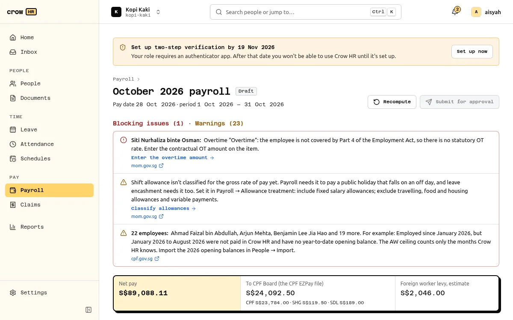

# Crow HR

Free, MIT-licensed HR and payroll for Singapore SMEs that you host yourself. By [Crow Tech Pte. Ltd.](https://crow.sg)

People records, leave, attendance and overtime, expense claims, shift rosters, documents and HR letters, approvals, reports and monthly payroll with CPF, SHG, SDL and an FWL estimate, itemised payslips, and the files you upload to CPF EZPay, your bank and myTax Portal. It runs as one container plus PostgreSQL on your own server, and sends nothing to Crow Tech.



## Quick start

You need Docker with the Compose plugin.

```sh
git clone https://github.com/Crow-Tech-Pte-Ltd/CrowHR.git && cd CrowHR
cp .env.example .env            # copy the settings
$EDITOR .env                    # set PUBLIC_URL, e.g. https://hr.example.sg
docker compose up -d            # start
docker compose logs app | grep -A3 'SETUP CODE'   # then open PUBLIC_URL and finish setup
```

Compose pulls the published image, [`ghcr.io/crow-tech-pte-ltd/crowhr:1`](https://github.com/Crow-Tech-Pte-Ltd/CrowHR/pkgs/container/crowhr) (amd64 and arm64), and upgrades are `docker compose pull && docker compose up -d`. Only `docker-compose.yml` and `.env.example` are needed from the checkout. To build the image yourself instead: `docker build -t crowhr:local .` and set `CROWHR_IMAGE=crowhr:local` in `.env`.

## Documentation

The documentation site lives in [`apps/docs`](apps/docs) and is published at **https://hr.crow.sg/docs/**. Build it locally:

```sh
bun install
bun run docs:build              # static site in apps/docs/dist
bun run docs:dev                # http://localhost:4321/docs/
```

Start with the [install guide](https://hr.crow.sg/docs/self-hosting/install/) and the [limitations](docs/limitations.md).

## Status

Version 1.0.0 ([changelog](CHANGELOG.md)). Crow HR has not yet been used for a real company's payroll: check its results before you pay or file.

**Built:**

- Self-hosting: Docker Compose, a setup wizard, automatic migrations, scheduled backups (encrypted once you set `BACKUP_PASSPHRASE`, which you should) and a `crowhr` CLI
- Sign-in: password + TOTP, Google Workspace, Microsoft Entra ID, generic OIDC; Singpass tested against Singpass staging, not production
- Members, roles, a server-enforced permission matrix, and an append-only audit log with hash chaining
- Company, structure, employees, CSV import, lifecycle, work passes, change requests
- Approvals, notifications, a Home list of work to do, and a ⌘K command palette
- Leave: statutory and Government-paid types, policies, calendar, part-timers in hours, the Government-paid leave report, year end
- Attendance: clock in/out with an offline queue, optional location/IP checks, timesheets with optional approval and locking, overtime claims (Part 4, 72-hour warning)
- Claims: types and caps, receipts, foreign currency, reimbursement through payroll or outside it
- Scheduling: shift templates, weekly rosters, conflicts and hour warnings, publishing, swaps and open shifts
- Payroll: CPF/SHG/SDL and an FWL estimate, inputs fed from leave, attendance, rosters and claims, payslips, the CPF EZPay file, an ISO 20022 bank file, the IR8A export with Appendix 8A and 8B
- Documents, HR letters and KETs, acknowledgements
- Reports with CSV/XLSX export
- Native apps for iPhone, iPad ([`apps/ios`](apps/ios)) and Android ([`apps/android`](apps/android)): payslips, leave, clock in/out (also offline), claims with receipt photos, schedule and approvals. They connect only to your own server and collect no data. Android: [Google Play](https://play.google.com/store/apps/details?id=crowtech.crowhr). iPhone and iPad: in App Store review
- A versioned REST API with an OpenAPI description (contract 1.0 frozen in [`packages/core/openapi/releases`](packages/core/openapi/releases)), used by the web and mobile apps
- An in-browser demo at https://hr.crow.sg

**Not built yet:**

- Direct submission to CPF, IRAS or banks: Crow HR produces the files and you upload them
- A bundled virus scanner: uploads are scanned only if you connect your own ClamAV
- Push notifications in the mobile apps: they refresh in the background and show local notifications instead

The statutory engine (`packages/sg-rules`) carries cited, effective-dated rules and is checked against CPF's published examples and its online calculator ([verification record](packages/sg-rules/VERIFICATION.md)). Crow HR is not approved or endorsed by CPF Board, IRAS or MOM, and it is not legal or tax advice: check results before you pay or file. Known gaps are listed in [docs/limitations.md](docs/limitations.md).

## Development

```sh
bun install
bun run dev                     # API on 127.0.0.1:8080 (PGlite), web app via Vite
bun run check                   # lint, typecheck, tests, sg-rules coverage, OpenAPI check, docs build
```

TypeScript throughout: Hono + Drizzle core, React web app, Astro Starlight docs. See [CONTRIBUTING.md](CONTRIBUTING.md), [AGENTS.md](AGENTS.md) and [docs/architecture.md](docs/architecture.md).

## Security

Please report vulnerabilities privately; see [SECURITY.md](SECURITY.md).

## Licence

[MIT](LICENSE) © Crow Tech Pte. Ltd. and contributors. The open-source packages and fonts Crow HR ships with, and their licences, are listed in [THIRD-PARTY-NOTICES.md](THIRD-PARTY-NOTICES.md) (also in the Docker image at `/app/THIRD-PARTY-NOTICES.md`).
