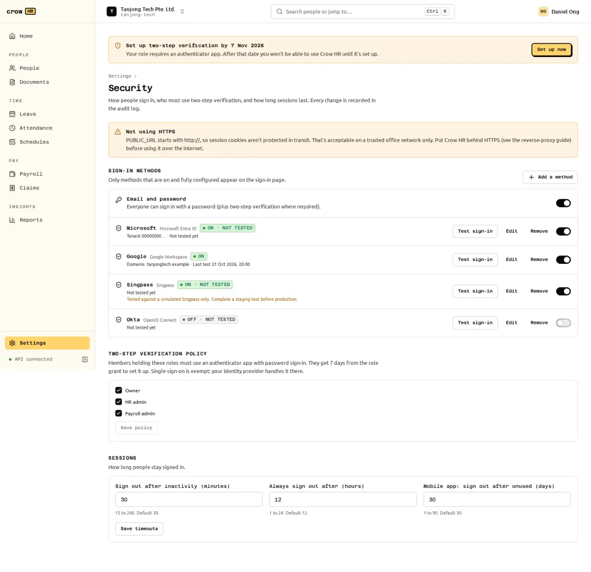

Owners choose the sign-in methods in **Settings → Security**. Each organisation has its own sign-in page (`/sign-in/<org-slug>`; plain `/sign-in` goes straight there when the server has only one organisation), and that page shows only the methods that are switched on **and** fully configured. It never reveals whether an email address belongs to a member.

## The methods

| Method | Notes | Guide |
| --- | --- | --- |
| Email and password | Always available out of the box. Optional two-step verification (TOTP), required for privileged roles by default. | [Two-step verification](/docs/admin/mfa/) |
| Google Workspace | OpenID Connect with Google; can be restricted to your Workspace domains. | [Google Workspace](/docs/admin/sso/google-workspace/) |
| Microsoft Entra ID | OpenID Connect restricted to one tenant. | [Microsoft Entra ID](/docs/admin/sso/microsoft-entra-id/) |
| OpenID Connect | Any provider with discovery: Okta, Keycloak, Authentik and others. | [Generic OIDC](/docs/admin/sso/generic-oidc/) |
| Singpass | Needs your company to be onboarded as a Singpass relying party. Not tested against real Singpass yet. | [Singpass](/docs/admin/sso/singpass/) |

All SSO methods use one OpenID Connect implementation (authorisation code flow with PKCE, `state` and `nonce`), with provider presets. Client secrets and private keys are encrypted at rest and never shown again after saving; the API only says whether one is set.

## Adding an SSO provider

1. In Settings → Security choose **Add a method** and the provider. The dialog lists where to find each value at the provider.
2. Fill in the client ID and secret (and tenant, domains or issuer, depending on the provider) and **Save**. Crow HR fetches the provider's discovery document and refuses to save with a readable error if it cannot. Saving needs a recent sign-in.
3. Copy the **redirect URI** shown after saving into the provider's app registration. It has the form `<PUBLIC_URL>/api/v1/auth/oidc/<provider id>/callback`, so `PUBLIC_URL` must already be the final address.
4. Use **Test sign-in**. A provider is saved switched off; turn it on after a successful test.

If a sign-in fails, the person sees a generic "Sign-in with … failed" message and the exact reason is recorded as `auth.sso_failed` in the audit log.

## How SSO accounts are linked

Crow HR has no open self-signup. An SSO sign-in works only for an identity linked to an active member of the organisation. On the first sign-in an identity is linked when:

- the provider asserts a **verified email** (`email_verified: true`, or an Entra token from your configured tenant) that equals the email of an existing active or invited member; or
- the sign-in started from that member's **invitation link**.

After that the identity is matched by its issuer and subject, not by email. Singpass identities are never linked by email or NRIC: only through an invitation or by a signed-in member linking it in **My sessions → Linked sign-in methods**, where members can also link other providers and unlink an identity unless it is their only way to sign in. Linking and unlinking are audit-logged.

Someone without a membership sees "Your account has not been set up in (organisation). Ask your HR team for an invitation".

### Creating accounts on first sign-in (JIT)

Off by default and not available for Singpass. When you switch on **Create accounts on first sign-in** for a provider, anyone with a verified email in that provider's allowed domains who has no membership gets one as a plain member with no role and no employee record. Emails outside the allowed domains are refused as if JIT were off. HR is not notified yet; the `member.jit_provisioned` audit event is the only record, so check the audit log or Settings → Members and link or remove such members.

## Turning off password sign-in

Once at least one SSO provider is switched on and has had a successful test sign-in, you can switch off email and password for staff. Members other than owners then get `password_sign_in_disabled` with the names of the SSO methods to use. **Owners can always sign in with their password** (break-glass, still with two-step verification), and that sign-in is audited as `auth.break_glass_sign_in`.

## Sessions

Settings → Security also sets how long people stay signed in:

| Setting | Default | Range |
| --- | --- | --- |
| Sign out after inactivity | 30 minutes | 15 to 240 minutes |
| Always sign out after | 12 hours | 1 to 24 hours |
| Mobile app: sign out after unused | 30 days | 1 to 90 days (for the planned native apps) |

People see and revoke their own sessions in **My sessions**. Changing or resetting a password and suspending a member revoke sessions too. Sensitive actions (changing the password, two-step verification or security settings, SSO configuration, role grants, revealing an NRIC/FIN or bank number, exports with sensitive fields) need a sign-in within the last 10 minutes.

When `PUBLIC_URL` is plain `http`, Settings → Security warns "Not using HTTPS": session cookies are not protected in transit. Put Crow HR behind HTTPS ([reverse proxy](/docs/self-hosting/reverse-proxy/)) before using it over the internet.
