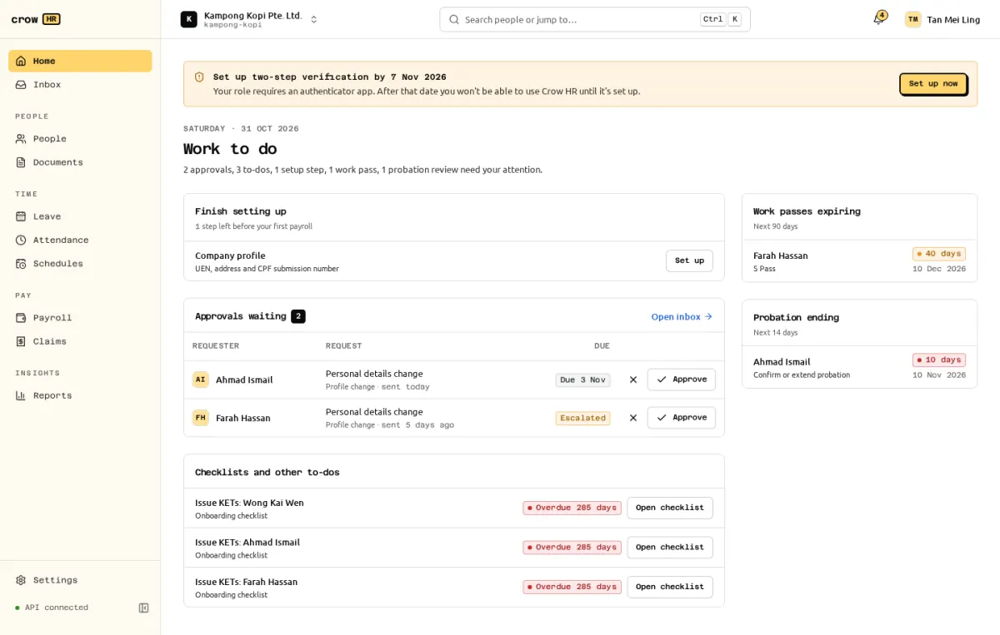
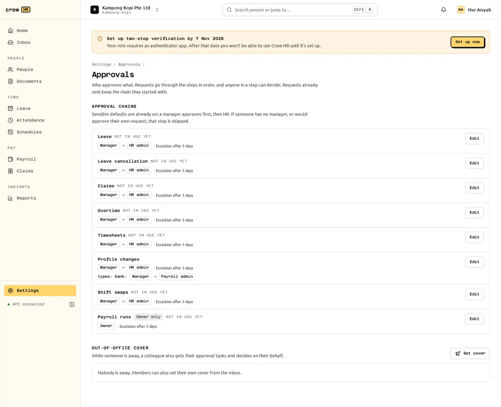

Every request that needs a decision goes through one approval engine:

- **profile changes** (employees' changes to legal, residency, race/religion and bank details);
- **payroll runs**;
- **leave**, **leave cancellation** ([leave](/docs/leave/leave/#approval)) and **leave encashment** ([encashment](/docs/leave/leave/#encash-unused-leave));
- **claims** ([claims](/docs/claims/claims/#approval));
- **overtime** claims ([attendance](/docs/attendance/attendance/#claiming-it));
- **shift swaps** and open-shift pickups ([scheduling](/docs/scheduling/scheduling/#swaps-and-open-shifts));
- employees' **employment letter requests** ([letters](/docs/documents/letters-and-kets/#employment-letter-requests)).

**Settings → Approvals** also lists **Timesheets** as "Not in use yet": timesheet corrections are made directly by managers and HR, without a request.

## Where approvers decide

- **Home** lists everything waiting for you, overdue first, then by due date. Profile changes can be approved or rejected inline.
- **Inbox** shows open tasks with the request's summary, the requester's context, the approval chain with its progress and earlier comments.

Rejecting needs a comment (1 to 500 characters); approving does not. When several people can decide a step, the first decision closes it and the others' tasks are marked superseded. Deciding a task that someone already decided gives `409 already_decided`.

## Policies

Owners and HR admins edit the chain for each request type in **Settings → Approvals**. Only owners edit policies for payroll runs, compensation and profile changes (which include bank details).

A policy has:

- an optional **condition**: an amount at or above a threshold, or a type code in a list;
- a **priority** (the highest-priority matching policy wins, otherwise the default);
- **1 to 5 steps**, each approved by the requester's **manager**, their **manager's manager**, anyone holding a **role** (HR admin, payroll admin, owner) or a **specific member**;
- an **escalation** after N calendar days (default 3; 0 turns it off).

Defaults, used until you edit them:

| Request | Default chain |
| --- | --- |
| Payroll run | Owner |
| Profile change | Bank details: payroll admin. Other fields: HR admin. |
| Leave, leave cancellation, overtime | Manager |
| Leave encashment | HR admin |
| Shift swap | Manager (escalates after 2 days) |
| Employment letter request | HR admin |
| Claims | Manager, then HR admin |

The chain is copied onto each request when it is submitted, so editing a policy does not change requests already in flight.

## When a step has nobody

A step is skipped (and the reason recorded) when it resolves to the requester themselves, to nobody (for example, no manager) or to a suspended or former member. If every step is skipped, the request goes to eligible HR admins, then owners. Payroll runs and bank changes fall back to owners. Only owners decide payroll runs; only payroll admins and owners decide bank changes. If no eligible member other than the requester exists, an owner who is the requester may decide, and the decision is marked **self-approved**. Explicit exclusions always apply, including to owners: someone who filed a request for another employee, benefits from a shift swap, or entered their own earnings in a payroll run cannot decide that request. If nobody eligible remains, the request stays pending. Appoint an uninvolved approver, then withdraw and resubmit the request to resolve its chain again. A request is never approved without a recorded decision by a member.

## Delegation (out-of-office cover)

Anyone who approves requests (an approver role, or tasks waiting) can set cover from the Inbox: a delegate, a start and end date (inclusive) and optionally which request types. While cover is active, the delegate also gets the delegator's tasks; the delegator keeps them too. A delegate must be eligible for the subject and cannot be the requester, filer or an excluded beneficiary. Role-based steps only go to delegates who hold that role, and the delegate can read a request only while its task is open. HR admins can set cover for anyone in Settings → Approvals.

## Escalation and reassignment

When a task passes its due time, its assignees get a reminder. Role steps escalate within that role, then to eligible owners, keeping the required role on the new task. Manager steps try the next manager, eligible HR admins, then owners. Every candidate must be allowed to decide that subject. This happens once per step.

Owners and HR admins can reassign a pending task to another eligible member holding the task's required role, with a reason (HR admins cannot reassign payroll run tasks). Nobody can reassign a task on a request they made, filed or benefit from. When a requester's manager changes, open manager tasks move to the new manager.

Suspending a member or making them former supersedes their open tasks, revokes cover to and from them, and re-resolves steps that have no approver left. Inactive members cannot act on approvals.

## Withdrawing

A requester can withdraw a pending request; open tasks are superseded and the approvers are told. A payroll run in review can be withdrawn back to draft.

## Background processing

Escalations, reminders, the email outbox and date-triggered changes (such as a leaver's membership becoming former) are processed by background jobs the server runs every 60 seconds. Nothing is processed twice, and after downtime the next run catches up.
