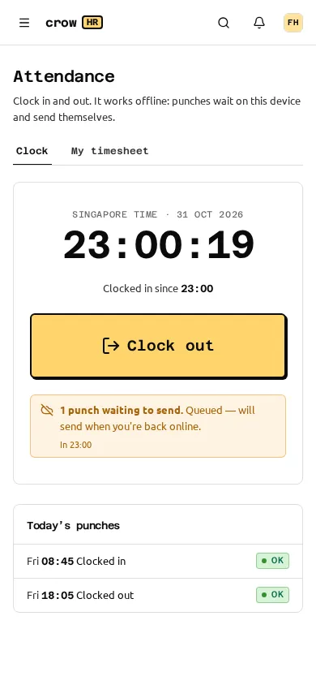
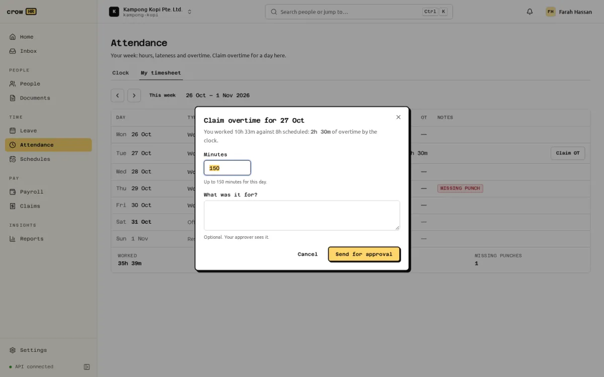

**Attendance** has four tabs: **Clock** and **My timesheet** for everyone with an employee record, **Team** for managers and HR, and **Summary** for the period report. Owners and HR admins set the rules under **Settings → Attendance**.

## Clocking in and out

**Clock** shows the time in Singapore, whether you are clocked in ("Clocked in since 08:45"), one big **Clock in** or **Clock out** button, and today's punches. Each punch is marked **OK**, or **Check** when it carries a flag (below). A punch your manager added says so.

The time recorded is the moment you tapped, corrected to the server's clock: Crow HR stores the device time, the time the device sent the punch, the time the server received it, and the corrected time it uses for your timesheet. A punch that is sent twice (for example after a dropped connection) is recorded once.

### Working offline

Punches work without a connection. A punch that can't be sent waits on the device and sends itself when the connection is back: on the next page load, when the browser comes back online, after your next tap, and every 30 seconds while the page is open. The screen says "1 punch waiting to send. Queued — will send when you're back online." Up to 200 punches can wait on one device. The queue is kept in the browser's local storage, so it survives closing the tab, but not clearing the site's data or switching device.

A queued punch that the server refuses (for example, one more than 7 days old) moves to a **Not recorded** card with the reason and "Ask your manager to add it if it was right."

### Flags and refusals

These are **refused**:

- a punch more than **7 days** old ("Ask your manager to add it to your timesheet");
- a punch more than a minute in the future, by the server's clock.

These are **flagged but never block**; the timesheet shows them and the punch is marked **Check**:

- **Clock skew**: the device's clock was off by more than the allowed skew (default 2 minutes, set under **Settings → Attendance**). The punch is corrected to server time: "Device clock was off; corrected to server time". The skew is estimated as server time minus the device's send time, so a slow network adds its delay to the estimate.
- **Late sync**: the punch reached the server more than 10 minutes after it was tapped (it waited offline). The tapped time is kept: "Sent late (offline); kept the time you tapped".
- **Outside every office** or **from another network**, when those checks are set to flag (below).

**Overnight work** is split at 04:00 Singapore time: a clock-out before 04:00 closes the previous day's open shift; anything later starts a new day. A published overnight shift follows the same rule.

## Location and office network (optional)

Both checks are off by default.

**Location** has three settings: **Don't collect location** (default), **Collect it when the device allows** and **Require it for every punch**. You can add up to 50 **offices** (name, latitude, longitude and a radius from 20 m to 5 km). **Outside every office** is either **Record and flag it** (default) or **Refuse the punch**, which tells the employee how far they are from the nearest office. Up to 50 m of the browser's reported accuracy is credited towards the radius. With no offices added, location is stored but not checked. When location is off, the browser does not ask for it, and the server drops any coordinates it is sent anyway.

**Allowed IP ranges** takes up to 50 IPv4 or IPv6 ranges in CIDR form (empty means any network). **From another network** is again flag (default) or refuse ("You can only clock in from the office network…").

Location reported by a phone can be faked on a rooted or jailbroken device; office IP ranges are the stronger control. Every refusal tells the employee to ask their manager to add the punch, which a manager can do as a correction.

:::note[PDPA notice]
Location is personal data. Before an employee's first punch with location on, Crow HR shows a notice titled "Your location and clocking in", from your organisation, and the employee must confirm it before the punch is sent; they can reopen it from "Why?" on the Clock screen. The default text says the location and network are recorded only to check that the employee is at an approved work location, kept with their attendance records, seen by their manager and HR, and not used for anything else. You can replace it under **Settings → Attendance → PDPA notice**. Collect location only if you need it, and say so in your own data protection notice; see [privacy and PDPA](/docs/help/privacy-pdpa/).
:::

## Timesheets

**My timesheet** shows one week (Monday to Sunday) with each day's type (working day, half day, off day, rest day, public holiday, leave, shift), first in, last out, hours worked, overtime and notes, and the week's totals: worked, overtime, late and missing punches. Timesheets are calculated from the punches whenever you open them; nothing is stored separately.

**Team** shows one day for your team (managers) or everyone (owners, HR admins, payroll admins): "6 in · 1 late · 1 missing a punch".

### How a day is worked out

- **Worked time** is first in to last out. For employees on a fixed week, the **unpaid break** (default 60 minutes) is taken off days longer than 6 hours; a rostered shift uses its own break instead.
- **Late** and **early out** are measured against the scheduled start and end. They count only beyond the grace (default 5 minutes each), and then the whole difference counts, not just the minutes past the grace. Half-day leave in the morning skips the lateness check; in the afternoon, the early-out check.
- **The scheduled start** is the **usual start** in settings (default 09:00) for fixed-week staff. For [rostered staff](/docs/scheduling/scheduling/#how-a-published-roster-is-used) on a date with a published roster, it is the shift's own start, end and break. Rostered staff without a published roster that week have no start time, so lateness and early out are not computed, and their scheduled time is a fifth of their weekly hours.
- **Missing punch**: a day with a clock-in but no clock-out (or the reverse) is marked **Missing punch** and has no worked time until it is corrected.
- Approved leave and public holidays show on the day.

### Corrections

Managers correct their team's timesheets, and owners and HR admins anyone's, from **Team → Correct**: **Remove** a wrong punch, or **Add a punch** (clock in or out, the time in SGT and a reason of 3 to 300 characters, which the employee sees). Removed punches are kept, marked void. Every correction is audit-logged. Nobody can correct their own timesheet, whatever their role. Corrections have no 7-day limit.

## Overtime

### What counts as overtime

On a working day (or a rostered shift), overtime is the time worked beyond the scheduled time. On a rest day, off day, public holiday or full day of leave, all time worked is overtime. Less than the **minimum OT** (default 30 minutes) is not overtime; the rest is rounded **down** to **OT blocks** (default 15 minutes).

### Claiming it

Overtime is paid only when it is claimed and approved. On **My timesheet**, a day with overtime has **Claim OT**: enter the minutes (up to what the timesheet shows for that day) and, optionally, what it was for, then **Send for approval**. One claim can be open or approved per day. If the timesheet shows no overtime, fix the punches first.

A claim goes to the employee's **manager** by default (escalating after 3 days); change the chain under **Settings → Approvals** ([approvals](/docs/approvals/approvals/)). The approver sees the date, the claimed and timesheet minutes, the basis and the reason, and approves or rejects the whole claim; partial approval is not possible. A pending claim can be withdrawn from the request in the Inbox.

### Part 4 eligibility

Each claim is marked **statutory** or **contractual** when it is made, using the statutory engine's Part 4 test of the Employment Act: the employment record must be marked as covered by the Employment Act, and basic monthly salary must be at most **S$4,500 for a workman** or **S$2,600 for anyone else**. Hourly-rated staff are compared using a monthly equivalent (hourly rate × weekly hours × 52 ÷ 12). A contractual claim says so: "Not covered by Part 4 … contractual (company policy)."

### The 72-hour monthly limit

The Employment Act limits overtime to 72 hours a month unless MOM grants an exemption. When a claim would take the employee's pending and approved overtime for the month past 72 hours, the employee is warned and the approver sees "OT in October: 75 of 72 h (over the 72-hour monthly limit: lawful only with an MOM exemption)". It is a **warning only**: Crow HR does not know whether you hold an exemption, so it never blocks.

## How approved overtime reaches payroll

Approved overtime goes to payroll automatically; nobody retypes it.

- When a payroll run is computed, each **approved** claim whose date worked falls in the run's period becomes an item "Overtime (approved in attendance)" with its minutes and date.
- A claim approved after the run was computed makes **Submit for approval** fail with a request to recompute; the recompute picks it up.
- Overtime is matched by the **date worked**, not the approval date, so it never rolls over to a later month. A claim for October approved after October's run is approved is not paid by November's run; reopen October as an [adjustment run](/docs/payroll/running-payroll/), which includes it. Approve overtime before the month's run is submitted.
- Bonus-only off-cycle runs ignore overtime.
- For **monthly-rated employees covered by Part 4**, payroll computes the pay at 1.5 × the hourly basic rate, with the working shown in the CPF drawer, and checks it is paid within 14 days after the salary period.
- Overtime typed in by hand on the run is still possible and is **added on top**; it does not replace the fed items, so don't enter the same hours twice.
- **Days worked** for rostered staff who clock in also comes from attendance ("Days worked (from attendance)"): days with worked time, plus public holidays and paid leave; no-pay leave days don't count. A "Days worked" item entered by hand on the run takes precedence. See [scheduling](/docs/scheduling/scheduling/#payroll-scheduled-days).

:::caution[Contractual and hourly-rated overtime]
A fed overtime item carries minutes, not an amount. For an employee **not covered by Part 4** the run blocks with `OT_NOT_STATUTORY` ("Enter the contractual OT amount"), and for an **hourly-rated** employee with `OT_AMOUNT_REQUIRED`. The run screen has no way to put an amount on an item that came from attendance, so for these employees don't approve overtime claims in Crow HR for now: pay their overtime as a manual overtime item with the amount, or as another earning.
:::

Work on a rest day or public holiday reaches payroll as plain overtime minutes. The separate rest-day and public-holiday pay rules (a day's or two days' basic pay, an extra day for a holiday) are shown as text on rosters but are not paid from attendance; enter them as items on the run.

## Summary report

**Summary** lists, per employee for up to 62 days, days worked, hours, late days, early outs, missing punches, overtime by the clock, approved overtime and leave days, with a **CSV** download. Managers see their team. The same figures are in [Reports](/docs/reports/running-reports/) as "Lateness, missing punches and overtime".

## Settings → Attendance

| Setting | Default |
| --- | --- |
| Location | Don't collect location |
| PDPA notice | The standard notice (blank) |
| Offices, and **Outside every office** | None; Record and flag it |
| Allowed IP ranges, and **From another network** | Any network; flag |
| Usual start (SGT) | 09:00 |
| Unpaid break (min), taken off days over 6 hours | 60 |
| Clock skew allowed (s) | 120 |
| Late after (min) | 5 |
| Early out grace (min) | 5 |
| OT in blocks of (min), rounded down | 15 |
| Minimum OT (min) | 30 |

Office checks that refuse punches need location, so saving location off with offices set to refuse is refused. Every change is audit-logged.

## Who can do what

| | Owner, HR admin | Payroll admin | Manager | Employee |
| --- | --- | --- | --- | --- |
| Clock in, claim overtime | Own | — | Own (as an employee) | Own |
| See timesheets | Everyone | Everyone | Team | Own |
| Correct timesheets | Everyone except themselves | — | Team | — |
| Attendance settings | Yes | — | — | — |

Owners and HR admins can also file an overtime claim for an employee through the API; the web app files claims for yourself only. The full rules are in the [permission matrix](/docs/roles-and-permissions/).

## Limitations

- Lateness for fixed-week staff is measured from one usual start time for the organisation; per-schedule start times exist in the API but have no screen.
- After a claim is rejected or withdrawn, the day shows that status instead of **Claim OT**; a new claim for that day can only be made through the API.
- The late-sync threshold (10 minutes) is fixed.
- There is no list of all overtime claims in the web app; approvers work from the Inbox.
