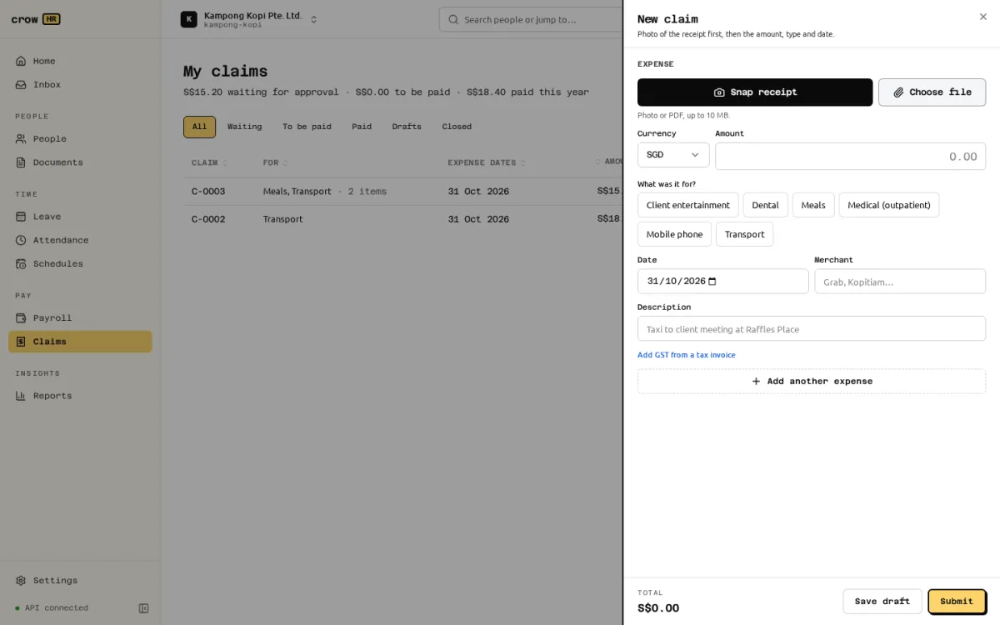
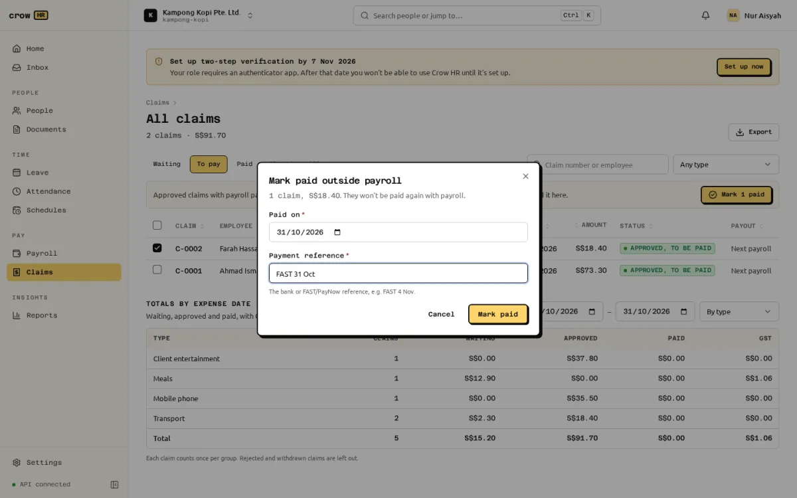

Employees file expense claims under **Claims**, with a photo or PDF of each receipt. Claims go through [approvals](/docs/approvals/approvals/) and are then reimbursed with the next payroll run, or paid by transfer and recorded as paid. Owners and HR admins set up claim types under **Settings → Claim types**.

## Claim types

A claim type has:

- a **name** and a **code** (2 to 32 capitals, digits or underscores, such as `TRANSPORT`), used in approval rules and exports;
- a **category**: medical, dental, transport, meals, entertainment, travel, phone, training or other. Medical receipts and details are shown only to HR, the employee and the current approver;
- a **receipt rule**: **Always required**, **Required above an amount** (a line strictly above it) or **Not needed**;
- an optional **cap** per employee: **Per claim**, **Per calendar month** or **Per calendar year**, one cap per type;
- **Who can claim**: employment types (full-time, part-time, contract, intern; none ticked means everyone), and whether it is **Available during probation**;
- whether **lines may carry GST**, whether it is a **taxable benefit**, how it is **paid** by default (**With payroll** or **By transfer, outside payroll**) and an optional **GL code** for your accounts.

On an empty list, Crow HR offers a starter set you can edit:

| Type | Receipt | Cap | Who can claim |
| --- | --- | --- | --- |
| Transport | Above S$20 | none | Everyone |
| Meals | Above S$10 | none | Everyone |
| Client entertainment | Always | none | Everyone |
| Medical (outpatient) | Always | S$500 a year | Everyone |
| Dental | Always | S$300 a year | Everyone |
| Mobile phone | Always | S$50 a month | Full-time |

Types are archived, not deleted, once used: an archived type disappears from the claim form, and a draft that still uses it can't be submitted. **Restore** brings it back.

The **submission window** (default 90 days, from 7 to 730) is how long after the expense date a claim may be filed.

Whether an employee can use a type (employment type, probation) is checked against their employment record as it is today, not on the expense date.

## Filing a claim

**My claims** shows your claims and totals ("S$15.20 waiting for approval · S$0.00 to be paid · S$18.40 paid this year") with tabs for **Waiting**, **To be paid**, **Paid**, **Drafts** and **Closed**. **New claim** opens the claim form:

1. **Snap receipt** (opens the phone camera) or **Choose file**.
2. Currency and amount, the type, the date, the merchant and a description.
3. **Add another expense** for more lines: a claim holds 1 to 30 lines, each with up to 5 receipts, and can mix types.
4. **Submit**, or **Save draft** to finish later. Drafts are only checked for structure; the full checks run on submit, and a claim that fails them stays as a draft.

Submitting checks that each line's type is open to you, the date is not in the future or older than the submission window, required receipts are attached and every merchant is filled in. The claim then gets a number such as `C-0004`.

### Caps

Caps are per employee and type, counted by expense date in Singapore time (the calendar month or year of the expense). The form shows what is left as you type ("S$30.00 left of S$100.00 in October"). On submit, this claim plus your waiting, approved and paid claims must fit the cap; on approval it is checked again against approved and paid claims, so two claims that each fit cannot both be approved over the cap. The error names the numbers: "Mobile phone has a monthly cap of S$50.00: used S$35.50, pending S$0.00, remaining S$14.50 for October 2026. This claim asks for S$20.00. Reduce the amount to S$14.50 or less."

### Duplicate receipts

A receipt file that is already attached to another submitted claim is flagged, not blocked: "Possible duplicate of claim C-0002: the same receipt image is attached there." The approver decides.

## Receipts

- **Accepted**: PDF, JPEG, PNG, WebP and HEIC/HEIF, up to **10 MB**. The type is checked from the file's content, never its name or extension; anything else is refused with "This file is not a PDF or image. Upload a photo or PDF of the receipt". Files that look like a disguised web page, script or archive are refused too.
- **Viewing**: JPEG, PNG and WebP receipts preview in the app. PDFs open in your PDF viewer, and HEIC files are stored but not previewed ("Preview not available. Download to view."). Downloads are served with the detected type and headers that stop the browser running them.
- **Who sees them**: the employee, approvers, HR and payroll admins, and managers for their team; for medical and dental-category lines, only owners, HR admins, the employee and the approver whose task is open.

:::caution[Receipts are not virus-scanned]
Crow HR has a hook for a virus scanner, but no scanner ships with it and none is configured by default. Receipts are stored **unscanned** and usable immediately, after the file-type and size checks above. Owners see "Virus scanning of receipts is off on this server" in **Settings → Claim types**; despite its wording, there is no server setting that turns scanning on (the ClamAV adapter is not built, and `CLAMAV_HOST` is not read). The hook is for developers: when a scanner is plugged into the server code, new receipts wait as "being scanned" and can't be submitted until they are clean, infected files are deleted and the uploader told, and a receipt that fails to scan three times is blocked.
:::

## Foreign currency

Pick the currency on a line and enter the **rate in SGD per 1 unit** (up to 6 decimal places), for example the rate on your card statement. The form shows the SGD amount as you type. Crow HR does not fetch exchange rates.

Each line is converted once and rounded half-up to the cent: MYR 125.50 at 0.301234 is S$37.80. The claim total is the sum of the rounded lines. Currencies without cents (JPY, KRW, VND) and with three decimals (KWD) are handled. GST can be entered only on SGD lines, from a tax invoice, and never more than the amount.

Approvers see the original amount, the rate and the SGD amount ("MYR 125.50 @ 0.301234"). There is no warning when a rate looks unusual.

## Approval

A submitted claim goes through the approval engine as a **Claims** request. The default chain is the employee's **manager**, then an **HR admin**, each escalating after 3 days. Under **Settings → Approvals** you can add rules, for example an extra owner step for claims of S$1,000 or more, or a different chain for certain claim types. A claim with several types is matched on its largest type by SGD amount.

- Approvers decide from **Home** or the **Inbox**; the request links to the claim with its receipts and any duplicate flags.
- Rejecting needs a comment, which the employee sees ("Not approved: …").
- The employee can withdraw a claim while it is waiting, and **Copy to new draft** a rejected or withdrawn claim to fix and resubmit it.

**Claims → All claims** (owners, HR admins, payroll admins) or **Team claims** (managers) lists everything in scope with tabs **Waiting**, **To pay**, **Paid**, **Closed** and **All**, shows how many days a claim has been waiting, totals by expense date (by type, department, employee or month, with GST), and **Export** of the line register, totals and payout register as CSV or Excel.

## Reimbursement

### Through payroll

Approved claims to be paid **with payroll** are added to the employee's next regular monthly run automatically:

- A run picks up every approved, unpaid claim whose **approval date** (Singapore time) is on or before the last day of the run's month. The payroll cutoff day in payroll settings only drives the reminder; it does not hold claims back.
- When the run is computed, those claims are reserved for it so no other run can pay them. Discarding a draft run releases them.
- A claim approved **after the run was computed** but while it is still a draft makes **Submit for approval** fail with a request to recompute, which picks it up.
- A claim approved **after the run was submitted**, or after the month ended, **rolls over** to the next month's run.
- The payslip shows one line per claim type ("Claims reimbursement: Transport") under **Reimbursements (not wages)**. Reimbursements are not wages: they add to net pay but not gross pay, attract no CPF and are not reported in the IR8A export.
- When the run is marked **paid**, its claims become **Paid**, dated the run's pay date.

Off-cycle bonus runs pay no claims; an off-cycle final-pay run pays the leaver's approved claims.

:::caution[Reopening a run that paid claims]
An adjustment run created by reopening a month does not carry the original run's claim reimbursements, so it shows them as overpaid. Until this is fixed, don't reopen a month only to correct something unrelated to claims without checking the adjustment's reimbursement lines against the original run.
:::

### Outside payroll

Claims whose types are paid **by transfer**, or any approved claim you choose to pay yourself, are recorded on **Claims → All claims → To pay**. Tick the claims, **Mark N paid**, and enter the date paid and the bank or FAST/PayNow reference. Up to 200 claims at once; the batch is refused if any claim is already in a payroll run, paid or not approved. A claim marked paid outside payroll is never paid again by payroll. Each one is audit-logged with the reference. Only owners and payroll admins can mark claims paid.

## Who can do what

| | Owner | HR admin | Payroll admin | Manager | Employee |
| --- | --- | --- | --- | --- | --- |
| File claims | Own | Own | Own | Own | Own |
| See claims | All | All | All | Team | Own |
| Edit claim types | Yes | Yes | — | — | — |
| Mark paid outside payroll | Yes | — | Yes | — | — |
| Claims report and exports | Yes | Yes | Yes | — | — |

Owners and HR admins can also file a claim on an employee's behalf through the API; the web app files claims for yourself only. See the [permission matrix](/docs/roles-and-permissions/).

## Not available

- Automatic exchange rates, and a warning for unusual rates.
- A per-employee cap-usage report.
- Mileage or per-diem claim types, and corporate cards.
- Cleanup of receipts uploaded but never attached to a claim.
- The **Taxable benefit** flag is recorded on the type but not yet used by payroll or the IR8A export.
