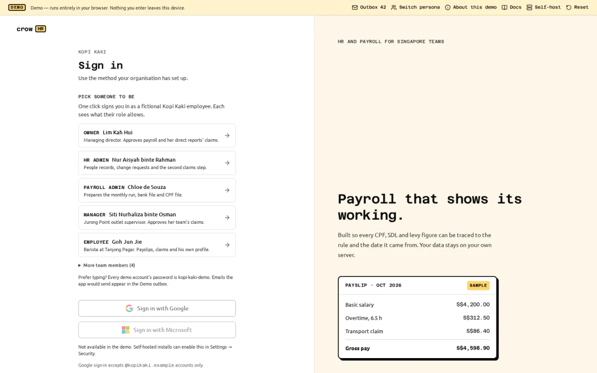

<span class="crow-pill crow-pill--soon">Not deployed yet</span>

Crow HR has an in-browser demo: the same web app and the same API code that a self-hosted install runs, started inside the visitor's browser instead of on a server. It is built and tested, but **it is not published anywhere yet**. It is meant to live at hr.crow.sg, next to these docs; deploying it is a separate, manual step that has not happened. Until it does, you can build and open it on your own machine (see [running it locally](#running-it-locally)) or [install Crow HR](/docs/quick-start/).



## How it works

- **No backend.** The site is static files. The Crow HR API runs in a Web Worker in your tab, against PostgreSQL compiled to WebAssembly (PGlite), saved in your browser's IndexedDB. Nothing you type reaches a server, and there are no analytics or third-party requests.
- **The real code.** Payroll is calculated by the real engine with the cited Singapore rules, approvals go through the real workflow engine, and permissions are enforced by the same server code as a self-hosted install.
- **Your own copy.** Each browser gets its own database, seeded on the first visit (about 3.4 seconds and roughly 7 MB of downloads; later visits open in under a second). **Reset** in the demo banner wipes your copy and loads the company fresh; clearing the site's data in your browser does the same. When a new version of the demo changes its data, your next visit starts from a fresh copy automatically.
- **One tab at a time.** Two tabs writing the same local database would corrupt it, so a second tab offers to take over instead.

## The demo company

Kopi Kaki Pte. Ltd. is a fictional café group with an office, a central kitchen and three outlets: 27 people across citizens, permanent residents in their first, second and later years, Employment Pass, S Pass and Work Permit holders, every self-help group fund, part-timers and employees on each CPF age boundary. Every name, NRIC/FIN, bank account and email address is invented.

July to September 2026 payroll is approved and paid; October is a computed draft with warnings. Claims, leave requests, change requests and approvals are waiting for each persona. The history was created through the real services and the public API, as the person who would have done each step.

Sign in with one click as one of five personas, or type any seeded account's email with the shared password `kopi-kaki-demo`:

| Persona | Name | What they do in the demo |
| --- | --- | --- |
| Owner | Lim Kah Hui | Managing director. Approves payroll and her direct reports' claims. |
| HR admin | Nur Aisyah binte Rahman | People records, change requests and the second claims step. |
| Payroll admin | Chloe de Souza | Prepares the monthly run, bank file and CPF file. |
| Manager | Siti Nurhaliza binte Osman | Jurong Point outlet supervisor. Approves her team's claims. |
| Employee | Goh Jun Jie | Barista at Tanjong Pagar. Payslips, claims and his own profile. |

## What differs from a self-hosted install

| Area | In the demo | Self-hosted |
| --- | --- | --- |
| Signing in | One click on a persona, or the shared password. Two-step verification is not required. | Email and password, two-step verification (required for admin roles by default), SSO. |
| Google, Microsoft, Singpass | Buttons are shown but disabled; no request is made to any identity provider. | Work once an owner configures them. |
| Email | Nothing is sent. Messages appear in the **Demo outbox** (from the banner), so invitation and reset links still work. | Sent over SMTP if configured. |
| Passwords | PBKDF2 in a demo-only format that a real server refuses. | argon2id. |
| Encryption at rest | NRIC/FIN and bank numbers are encrypted with a key generated for your browser and stored next to the demo database. Fine for invented data, never a pattern for real data. | Encrypted with the server's `CROWHR_SECRET_KEY`. |
| Date | The company lives on 31 Oct 2026: the clock starts there at your Singapore time of day, then runs normally. Reset re-anchors it. | The real date. |
| Uploaded files | Stored in the browser database. | Stored on the server's disk volume. |
| Background jobs | Reminders, escalations and the outbox run every 30 seconds while a demo tab is open, and catch up on the next visit. | Every 60 seconds in the server process. |
| Backups and system status | Not applicable. | Daily `pg_dump` to the backups volume. |

## What the demo does not show

- **No attendance, rosters or documents are seeded.** October's overtime and rostered staff's scheduled days were entered by hand on the payroll runs. Clock in yourself to see a timesheet fill, or build a roster under **Schedules**.
- Every run shows the `YTD_BEFORE_CROWHR_MISSING` warning on purpose: the January–June opening balances are not imported, as for a company that moved to Crow HR mid-year.
- Receipt previews and PDF or CSV downloads go through a service worker. Where service workers are unavailable (some private-browsing modes), those previews and downloads fail; everything else works.
- A tab closed in the middle of a request can lose that one request.
- Nothing is filed with CPF Board, IRAS or a bank, here or in the product: Crow HR produces the files for you to upload.

The demo's own **About this demo** page (`/about-demo`) lists the same differences for visitors.

## Running it locally

From a checkout, with [Bun](https://bun.sh) installed:

```sh
bun install
bun run demo:site                                    # builds the demo and these docs into apps/demo/dist-site
node apps/demo/scripts/serve.ts apps/demo/dist-site  # http://127.0.0.1:5181
```

The preview server applies the same headers and redirects as the static host would. Keep it on your own machine: the demo has a shared password and no real security, by design.
