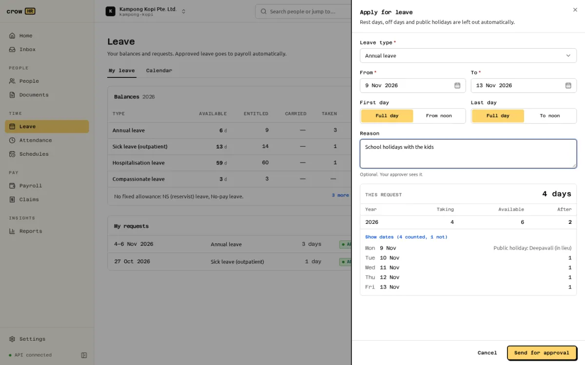
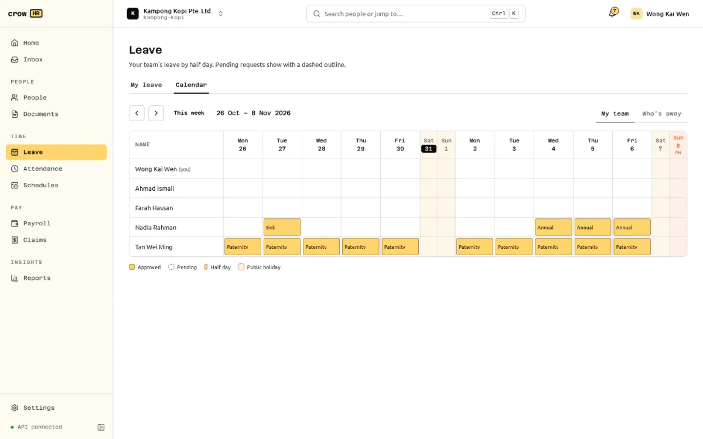
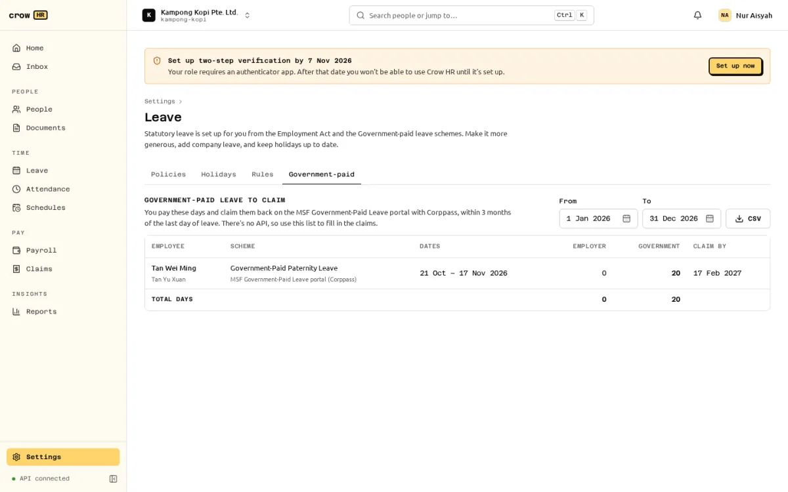

**Leave** has two tabs: **My leave** (your balances, requests and children) and **Calendar** (your team's leave). Owners and HR admins set policies, holidays and rules under **Settings → Leave**. Statutory leave is set up for each organisation automatically from the Employment Act and the Government-paid leave schemes, the first time anyone opens Leave.

The leave year is the **calendar year**.

## Leave types

### Statutory types

| Type | Entitlement | Eligibility | Paid by |
| --- | --- | --- | --- |
| Annual leave | 7 days in the first year of service, rising by one day a year to 14 days from the 8th year | 3 months' service | Employer |
| Sick leave (outpatient) | 5 days after 3 months' service, 8 after 4, 11 after 5, 14 from 6 months | 3 months' service | Employer |
| Hospitalisation leave | 15, 30, 45, then 60 days on the same steps; outpatient days count towards the 60 | 3 months' service | Employer |
| Maternity leave | Citizen child: 16 weeks (Government-Paid Maternity Leave). Other child: 12 weeks under the Employment Act | 3 months' service before the birth | Citizen child: employer weeks 1–8 and Government 9–16 for the 1st and 2nd child, Government all 16 from the 3rd. Other child: employer weeks 1–8, weeks 9–12 unpaid (all unpaid from the 3rd child) |
| Paternity leave | Citizen child, father married to the mother: 4 weeks for births from 1 Apr 2025 (earlier dates use the rows in force then); 2 weeks for a stillbirth | 3 months' service | Government |
| Shared parental leave | 6 weeks for children born from 1 Apr 2025, 10 weeks from 1 Apr 2026; not for a stillbirth | 3 months' service | Government |
| Adoption leave | 12 weeks, for a citizen child under 12 months at the formal intent to adopt | 3 months' service | Employer weeks 1–4, Government 5–12; Government all 12 from the 3rd child |
| Childcare leave | 6 days a year for a citizen child under 7 (pro-rated in the first year of service); 2 days under the Employment Act otherwise | 3 months' service | Citizen child: employer days 1–3, Government 4–6. Otherwise employer |
| Extended childcare leave | 2 days a year for a citizen child aged 7 to 12, when there is no child under 7 | 3 months' service | Government |
| Unpaid infant care leave | 12 days a year for a citizen child under 2, at most 24 days per child | 3 months' service | Unpaid |
| NS (reservist) leave | No fixed allowance; needs the call-up notice | — | Employer, with make-up pay from MINDEF |
| No-pay leave | No fixed allowance | — | Unpaid |

Children's ages are taken on 1 January. Crow HR also creates **Compassionate leave** (3 days) as a company type you can change.

Parental and childcare leave are per child. Employees add their children under **My leave → Children** (name, date of birth or due date, citizenship and birth order), and pick the child when they apply.

### Company types

**Company leave type** under **Settings → Leave → Policies** adds your own type, such as birthday leave or study leave, with a code and name, paid or unpaid, half days, a supporting-document rule, whether it is private, and a policy. Company types count working days. They can be archived and restored; statutory types cannot be archived.

## Policies, accrual and carry-forward

Each type's policy is edited from **Settings → Leave → Policies**:

- **Entitlement**: **Statutory minimum**, **Same days every year**, **By years of service** (steps you add) or, for company types, **No fixed allowance**.
- **Months of service before it can be used** (the Employment Act allows at most 3).
- **Pro-rate in the first year and the year of leaving**. Annual leave is pro-rated by completed months in the first calendar year of service and the year of leaving, half a day or more rounding up; later years use the service year reached by 31 December. Each balance explains how it was worked out.
- **Earned**: **All on 1 January**, or **Month by month** (completed months × yearly days ÷ 12, rounded down to a half day). With monthly accrual, a request is checked against what will have been earned by its last day.
- **Carry unused days into next year**, **Up to (days)** (blank means all) and **Use within (months)** (blank means they never expire). Annual leave carries everything forward by default, to be used within 12 months.
- **Allow leave encashment (including unused year-end days)**, and **Allow employees to request encashment** if staff may ask themselves (see [encash unused leave](#encash-unused-leave)).
- **Allow half days**, **Private** (colleagues see only "On leave"), and the **Supporting document**: not asked for, optional or required.

The Employment Act sets the floor, and Crow HR refuses a policy below it (`below_statutory`): annual leave below the statutory scale in any service year, sick leave below 14 days or hospitalisation below 60, more than 3 months' service required, or parental and childcare types moved off the statutory entitlement. Parental, childcare, infant care, NS and no-pay entitlements are fixed by law and can't be edited.

**Settings → Leave → Rules** has three organisation-wide settings:

| Setting | Options (default first) |
| --- | --- |
| A public holiday on an off day | **Pay an extra day (payroll); no day off**, or **Give the next working day off** |
| No-pay leave and service | **Only months that are entirely no-pay leave**, **Any month with a day of no-pay leave**, or **Keep counting service** |
| Comparable full-timer (for part-timers) | **The default work schedule**, or a fixed schedule you choose |

MOM's guidance is ambiguous on whether one day of no-pay leave removes a whole month from the service count, hence the setting.

## Applying for leave

**Apply for leave** on My leave opens the form: the leave type, the dates, the child where needed, an optional reason and the supporting document. For a single day, choose **Full day**, **Morning** or **Afternoon**; over several days, the first day can start **From noon** and the last day end **To noon**.

As you fill it in, Crow HR shows how many days the request takes from each leave year, what is available and what is left after it. **Show dates** lists each date and why any date is not counted (rest day, off day, public holiday, not rostered). Rest days, off days and public holidays are left out automatically; for maternity, paternity, shared parental and adoption leave, public holidays inside the leave count, as the schemes count weeks.

A request is refused when it overlaps another pending or approved request (a morning and an afternoon don't clash), the balance after pending requests is too small, you are not eligible yet, the type doesn't allow half days, a date is outside your employment, no date is a working day, it spans more than 200 calendar days, or a required document is missing. Leave across 31 December is split between the two leave years.

**Supporting documents** (PDF, JPEG, PNG, WebP or HEIC, up to 5 MB) are checked by their content. A medical certificate is required for outpatient sick and hospitalisation leave and an NS call-up notice for NS leave by default. Attachments can be opened only by the employee, owners, HR admins and an approver while their task on the request is open; to anyone else they don't exist. Uploads go through the same content checks and optional virus scan as other files.

**On behalf**: owners and HR admins can apply for an employee (the form has an **Employee** field for them). The request is routed exactly as if the employee had made it and shows "Entered by HR".

### Approval

Leave requests go through the approval engine as **Leave**, to the employee's **manager** by default (escalating after 3 days; to HR admins when there is no manager). Change the chain under **Settings → Approvals** ([approvals](/docs/approvals/approvals/)). Approvers decide from Home or the Inbox. The balance is checked again at approval: if it no longer covers the request, approval is refused until the request is rejected or the balance adjusted.

- A pending request can be **withdrawn** by the employee.
- An approved request can be cancelled with **Cancel leave** and a reason. That sends a **Leave cancellation** request for approval; the leave stays booked until it is approved, and then the days return to the balance.
- Owners and HR admins can **Cancel leave now** without approval (not their own leave). It is recorded in the audit log.

When leave is approved for a date where the employee already has a shift on a published roster, the roster's last publisher and the HR admins are told to reassign the shift. See [scheduling](/docs/scheduling/scheduling/).

## The calendar

**Calendar** shows two weeks at a time by half day; pending requests have a dashed outline and public holidays are marked.

- **My team** (managers) or **Everyone** (owners, HR admins, payroll admins) shows each person's leave type and pending requests, with a link to the request.
- **Who's away** shows colleagues outside your scope too, but only approved leave, and only the type's name for non-private types. Private types show "On leave". Reasons are never shown.

Outpatient sick, hospitalisation, maternity, unpaid infant care, compassionate and no-pay leave are private by default.

## Public holidays and days in lieu

Crow HR includes the gazetted public holidays for 2026 and 2027. Add extra holidays, such as Polling Day, under **Settings → Leave → Holidays → Add an extra holiday**.

When a holiday doesn't fall on a working day, Crow HR follows MOM's rules for leave counting:

- A holiday on a **Sunday** that is the rest day moves to the gazetted Monday.
- A holiday on any other **rest day** moves to the next working day, shown as "Deepavali (in lieu)".
- A holiday on an **off day** (for example a Saturday in a Monday-to-Friday week) depends on the rule above. With **Give the next working day off**, the next working day is a holiday in lieu and is not counted as leave. With **Pay an extra day (payroll); no day off**, no day off is created, and the extra day's salary is owed instead.

:::note[How the extra day is paid]
With **Pay an extra day (payroll)**, payroll adds one day's gross pay for the holiday to employees covered by the Employment Act who are paid monthly on a fixed week, once their allowances are classified for the gross rate ([allowance treatment](/docs/payroll/settings/#allowance-treatment)). For hourly-paid or rostered staff the run blocks until you enter the day's gross pay on the run ([holiday pay and contractual overtime](/docs/payroll/settings/#holiday-pay-and-contractual-overtime-on-a-run)).
:::

## Part-timers: leave in hours

Employees whose employment type is **part-time** hold annual leave, sick and hospitalisation leave and company working-day types **in hours**, using MOM's formula:

part-timer's weekly hours ÷ full-timer's weekly hours × full-timer's days × full-timer's hours a day

rounded half up to one decimal place, as in MOM's examples. The comparable full-timer is the schedule named in **Rules**, or the default fixed schedule (its longest working day gives the hours a day; with neither, 44 hours a week and 8 a day). The part-timer's weekly hours come from their own work schedule. Each day of leave takes that day's scheduled hours, or half of them for a half day.

The regulation's own rounding could not be confirmed, so balances in hours carry the warning `PT_LEAVE_ROUNDING_UNVERIFIED`.

## Government-paid leave report

Employers pay Government-paid leave and claim it back from the Government. Crow HR can't submit these claims (the government portal has no API), so it lists what to claim: **Settings → Leave → Government-paid**, for owners, HR admins and payroll admins.

Pick the dates. Each row shows the employee and child, the scheme and where to claim it, the dates, the employer-paid and Government-paid days in the period, and the **claim by** date (3 months after the last day of leave; NS make-up pay is claimed automatically by MINDEF). **CSV** downloads the same rows with the unpaid days and the claim route. Use it to fill in the claims on the government portal with Corppass.

The report lists **days only**: it does not compute amounts or apply the schemes' weekly caps. For shared parental leave, Crow HR does not know how much the other parent has used; the parents' split is theirs to declare.

## Year end

At the start of each new year, a background job closes the previous leave year for every employee, once:

- unused days carry forward up to the policy's cap, and expire after the policy's period (carried days are used first, and expired days never carry forward again);
- for employees covered by Part 4 of the Employment Act (monthly-paid, under the salary threshold), at least their unused statutory annual leave carries forward for 12 months, whatever the policy says;
- the rest is forfeited or, where the policy allows encashment, recorded as encashed days.

There is no button: it runs in the server's background jobs, and running it again changes nothing. Encashed days need an approved payout request before payroll pays them; use **Request payout** on the employee's Leave tab.

## How leave reaches payroll

Approved leave of every **unpaid** type (no-pay leave, unpaid infant care leave and unpaid company types) goes to payroll automatically: each payroll run adds the approved days in its period, in half days, as items such as "No-pay leave (approved in Leave)", and payroll reduces salary for them. A no-pay leave item entered by hand on the run for the same date replaces the fed one. Leave being cancelled still counts until the cancellation is approved.

The unpaid weeks of Employment Act maternity leave (weeks 9 to 12, for a non-citizen child) are not fed to payroll; enter them on the run.

## Encash unused leave

Turn on **Allow leave encashment** in a paid leave type's policy (**Settings → Leave → Policies**). Turn on **Allow employees to request encashment** as well if staff may ask themselves; otherwise only HR can.

- HR: **People → employee → Leave → Encash leave**. Employees: **Leave → Leave encashment → Encash leave**. Choose the type and quantity, and **Send for approval**.
- Days encashed at year end have a **Request payout** action instead. They were deducted at year end and are not deducted again; if the payout is rejected or withdrawn, they go back to that year's balance.
- A pending request holds its quantity. Approval deducts it from the balance; rejection or withdrawal releases it. Only a pending request can be withdrawn; an approved payout needs a payroll correction.
- The request goes through [approvals](/docs/approvals/approvals/) as **Leave encashment**, to HR admins by default (escalating after 3 days). Only HR admins, payroll admins and owners can decide, and never on their own payout.
- The card shows each request as awaiting approval, awaiting payroll, in payroll, paid, rejected or withdrawn, with the rate working.

Approved encashment is paid by the next regular payroll run, or a leaver's off-cycle **Final pay** run ([running payroll](/docs/payroll/running-payroll/#leave-encashment)).

**Rate.** Encashment uses the [MOM gross rate of pay](https://www.mom.gov.sg/employment-practices/salary/monthly-and-daily-salary): monthly gross is basic salary plus the fixed allowances included in the gross rate, in force when the request is made (on the last working day if the employee has left). For monthly-paid staff the daily gross rate is `12 × monthly gross / (52 × average workdays per week)`; the exact rate is multiplied by the days and rounded once, half up, to the cent. For example, S$2,600 basic plus a S$260 included allowance is S$2,860 monthly gross, S$132 a day on a five-day week, and S$330 for 2.5 days.

- Each of the employee's active allowances must be classified as in or out of the gross rate first ([allowance treatment](/docs/payroll/settings/#allowance-treatment)); an unclassified one blocks the request and is named.
- For shift staff, enter the contractual average workdays per week on the request; the approver checks it.
- Balances kept in hours use the gross hourly rate: monthly gross × 12 / (52 × contractual weekly hours). For hourly-paid staff, the hourly equivalent of included monthly allowances is added to the hourly rate.
- Later changes to salary, allowances or their classification don't reprice a request already made.

**CPF.** [CPF is payable on encashed leave](https://www.cpf.gov.sg/service/article/are-cpf-contributions-payable-on-encashment-of-leave), including leave paid on termination: it is earned leave, not termination compensation, and accumulated leave is [additional wages](https://www.cpf.gov.sg/employer/employer-obligations/what-constitutes-wages-for-cpf-contributions). For payments after someone has left, [CPF's rules for ex-employees](https://www.cpf.gov.sg/service/article/are-cpf-contributions-payable-on-additional-wages-payable-to-ex-employees-after-they-have-left-employment) apply.

## Reports

[Reports](/docs/reports/running-reports/) has **Leave taken** and **Leave balances and liability**, for owners, HR admins and managers (their team).

## Who can do what

| Task | Owner, HR admin | Payroll admin | Manager | Employee |
| --- | --- | --- | --- | --- |
| Apply for leave | Own, or for anyone | Own | Own | Own |
| See requests and balances | Everyone | Everyone | Team | Own |
| Policies, holidays, rules | Yes | — | — | — |
| Government-paid report | Yes | Yes | — | — |

## Limitations

- **Balance adjustments** and editing a child's record exist only in the API.
- An employee can attach one document when applying; more, or later, only through the API.
- **Shift workers**: dates in a week covered by the employee's published roster count only when they have a shift. Dates without a published roster count every day except public holidays, with a warning on the quote. Leave already applied for keeps its count even if the roster changes later. Parental leave assumes a 5-day week for shift workers.
- Employment Act maternity leave for a non-citizen child approximates "fewer than 2 living children" by birth order.
- The lifetime caps per child for childcare leave are not enforced, and the 2026 National Day Rally childcare changes are not applied.
