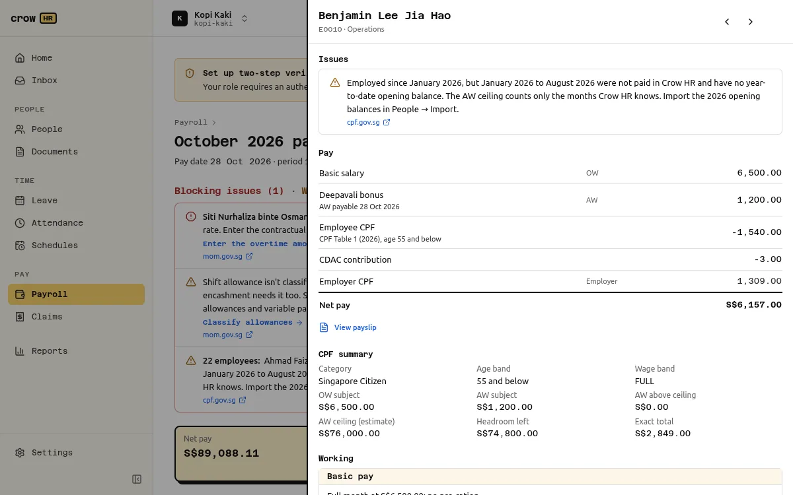

Open an employee in a payroll run to see the drawer: every pay line, **CPF at a glance**, the full **working** and the issues. Every step names the rate table it used, its effective date and a link to CPF's source.

## CPF at a glance

| Field | Meaning |
| --- | --- |
| Category | `SC` (citizen, or SPR from the third year) or an SPR graduated category for the first two years of PR status. |
| Age band | From the date of birth: 55 and below, above 55 to 60, above 60 to 65, above 65 to 70, above 70. |
| Wage band | Which part of the rate table applies to the month's total wages: up to S$50 (no CPF), above S$50 to S$500 (employer only), above S$500 to S$750 (phase-in) or full rates above S$750. |
| OW subject | Ordinary wages subject to CPF, capped at the monthly OW ceiling. |
| AW subject | Additional wages subject to CPF this month, after the AW ceiling. |
| AW above ceiling | Additional wages not subject to CPF because the AW ceiling was reached. |
| AW ceiling (estimate) | The year's AW ceiling as estimated this month (see below). |
| Headroom left | How much more AW can be subject to CPF this year. |
| Exact total | The total contribution before rounding. |

## Ordinary and additional wages

- **Ordinary wages (OW)** are wages for the month's work, payable by the 14th of the next month: basic pay, most fixed allowances, overtime.
- **Additional wages (AW)** are not granted wholly for the month's work: bonuses, the annual wage supplement, non-monthly commission.

Crow HR does not decide this for you. Each earning item is marked OW or AW by whoever enters it, and each allowance type is OW unless set otherwise. CPF's page on [what constitutes wages](https://www.cpf.gov.sg/employer/employer-obligations/what-constitutes-wages-for-cpf-contributions) is the authority.

## The OW ceiling

OW subject to CPF is capped per employee, per employer, per month: **S$8,000** from 1 January 2026 (S$7,400 in 2025), as in CPF's [contribution rate tables](https://www.cpf.gov.sg/content/dam/web/employer/employer-obligations/documents/CPFcontributionratesfrom1Jan2026.pdf). OW above it is not subject to CPF.

## The AW ceiling

The AW subject to CPF in a year is limited by the **AW ceiling** ([CPF: OW and AW ceilings](https://www.cpf.gov.sg/service/article/what-is-the-ordinary-wage-ow-ceiling)):

> AW ceiling = S$102,000 (annual salary ceiling) − total OW subject to CPF for the year

Because the year's OW is not known until December, CPF's procedure has two steps, and Crow HR follows it:

1. **Estimate** when AW is paid: the OW subject so far, plus the expected OW for the rest of the year (or until the employee's known last month).
2. **Recompute** in December, or in the employee's last month: with the actual OW, earlier AW is re-allocated in date order. If the ceiling grew, the extra AW becomes subject (a top-up, shown as a shortfall line); if it shrank, the excess contribution is flagged for a refund from CPF (`CPF_AW_EXCESS_REFUND`). Refunds are applied for with CPF and never netted or deducted.

The AW ceiling uses the date each AW became **due and payable**, so enter that date on every AW item.

If you started using Crow HR during the year, [import year-to-date opening balances](/docs/people/importing/#year-to-date-opening-balances). Otherwise the estimate counts only the months Crow HR knows and every employee shows `YTD_BEFORE_CROWHR_MISSING`.

The engine replays all 16 worked examples in CPF's AW ceiling guide month by month and matches every figure to the dollar (see [how we verify](/docs/payroll/verification/)).

## SPR graduated rates

In the first two years of Singapore permanent residence, CPF rates are graduated. The year is counted from the PR start date on the employee's record, so that date must be right. Three options exist:

| Option | Employer | Employee |
| --- | --- | --- |
| G/G (default) | graduated | graduated |
| F/G | full | graduated |
| F/F | full | full |

F/G and F/F are a joint election with CPF Board. Crow HR stores the option and the month it applies from on the employee's record and never infers it; record it only once CPF has approved it. From the third year, citizen rates apply.

In the month someone becomes a PR, only the wages from the PR date (and AW payable on or after it) count, and the engine raises `CPF_SPR_CONVERSION_MONTH` so you can check the split.

## Rounding

Crow HR rounds exactly as CPF's online calculator does (confirmed in 15 of 15 cases):

1. Apply the rate to the exact wage, without rounding the wage first.
2. Round the **total** contribution to the nearest dollar (50 cents rounds up).
3. Drop the cents from the **employee** share.
4. **Employer** share = total − employee share.

Money is held as integer cents throughout; nothing uses floating point.

## Rates for future years

The engine carries CPF rate tables for 2025, 2026 and 2027 as published by CPF. CPF publishes next year's rates during the year; until the 2028 tables exist, months from January 2028 use the 2027 tables and every result carries the warning `CPF_RATES_ASSUMED_CARRIED_FORWARD`.

## Cases Crow HR refuses

- A month with total wages above S$50 and up to S$750 where part of the AW is above the AW ceiling (`CPF_LOW_WAGE_CAPPED_AW_UNSUPPORTED`). CPF publishes no rule for it, so the run blocks for that employee instead of guessing.
- Negative wages. A correction recomputes the original month with corrected inputs (an adjustment run).

See [limitations](/docs/payroll/limitations/#cpf) for the open CPF questions.
