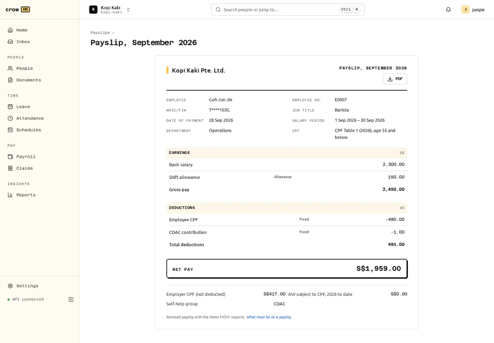

Every employee in an approved run gets an itemised payslip. Employees see their own released payslips under **Payslips** (web and PDF); former employees keep read-only access to theirs.

## Contents

Payslips contain the items MOM lists for [itemised payslips](https://www.mom.gov.sg/employment-practices/salary/itemised-payslips):

- employer's full name and employee's full name;
- date of payment and the start and end of the salary period;
- basic salary, or for hourly-rated staff the rate and hours;
- fixed and ad hoc allowances, and other additional payments;
- fixed and ad hoc deductions, including employee CPF and no-pay leave;
- overtime hours and pay, with the overtime period when it differs from the salary period;
- net salary.

They also show employer CPF (not deducted), the self-help group fund, the CPF rate table and age band used, and the year-to-date AW subject to CPF. NRIC/FIN is masked.

A payslip missing a mandatory item cannot be released: the release fails and names the item, for example "Employer's full name" when the company profile has no legal name.

## Release

Payslips stay hidden from employees until the run is approved **and** released by a payroll admin or owner (or automatically on approval, if you turned that on in [payroll settings](/docs/payroll/settings/)). Before release, an employee gets `404` for their payslip. Release is audit-logged. Employees are **not notified** of a release yet (the notification type exists but the payroll module does not send it), so tell them their payslips are available.

Payroll admins can preview any payslip, including the PDF, before release.

An adjustment run's payslip is labelled as a revision of the original and shows what is still payable or was overpaid.

## PDF

PDFs are rendered by a pure-JavaScript renderer with fonts shipped in the repository, with no downloads at run time. The same payslip always renders to a byte-identical PDF, so a payslip downloaded twice has the same SHA-256. Amounts are formatted `S$1,234.56` and dates `31 Oct 2026`.

## Not available

- A notification when payslips are released.
- Payslip emails with the PDF attached (by design, emails never carry pay data).
- Daily-rated and piece-rated pay units on the payslip.
