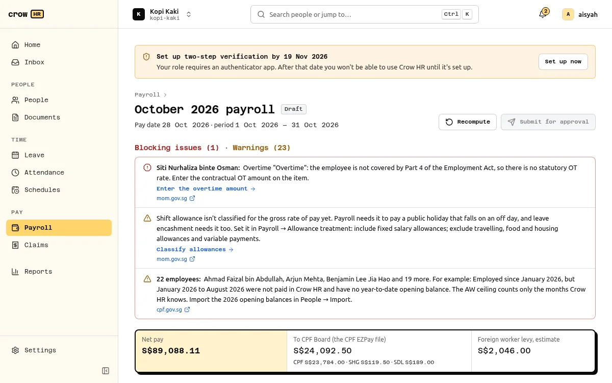

A payroll run covers one organisation and one calendar month. It moves through four states:

**Draft** (inputs editable) → **In review** (waiting for approval) → **Approved** → **Paid** (locked).

## 1. Create the run

**Payroll → New payroll run**. Choose the month and kind:

| Kind | Who is in it | Use it for |
| --- | --- | --- |
| Monthly (regular) | Everyone employed in the month | The normal monthly payroll. One per month. |
| Off-cycle final pay | The employees you choose; they are then left out of that month's regular run | Paying a leaver before the regular run. |
| Off-cycle bonus | One-off payments only | A bonus paid outside the regular run. CPF is recomputed for the whole month and the difference charged. |
| Adjustment | Created by reopening an approved or paid run | Corrections (see below). |

The pay date defaults from [payroll settings](/docs/payroll/settings/).

## 2. Add the month's items

Basic pay and recurring allowances come from People. Some items arrive on their own from the other modules each time the run is computed (see [items fed from other modules](#items-fed-from-other-modules) below); everything else is an item on the run, entered by hand:

- **Earnings**: bonus, commission, back pay, other earnings. Each is ordinary wages (OW) or additional wages (AW); an AW item needs the date it became **due and payable**, inside the run's period (CPF keys the AW ceiling to that date).
- **Overtime**: minutes worked and the period in which they were worked. For employees covered by Part 4 of the Employment Act, the pay is computed with the statutory rate; for others, enter the contractual amount (the run blocks with `OT_NOT_STATUTORY` until you do).
- **No-pay leave** in days, **hours** for hourly-paid staff, and **scheduled days / days worked** for staff without a fixed working week, when they are not fed.
- **Deductions**, each in an Employment Act category (accommodation, amenities, damage or loss, advance, loan, unauthorised absence, court order or tax, co-operative society, written consent and others), plus **CPF AW recovery** for an AW top-up (see [limitations](/docs/payroll/limitations/#cpf)).

### Items fed from other modules

When the run is computed, Crow HR adds these items itself, each labelled with where it came from:

| Item | From | Rule |
| --- | --- | --- |
| No-pay leave, unpaid infant care leave, unpaid company leave | [Leave](/docs/leave/leave/#how-leave-reaches-payroll) | Approved days in the run's period, in half days. A no-pay leave item you enter for the same date replaces it. |
| Overtime | [Attendance](/docs/attendance/attendance/#how-approved-overtime-reaches-payroll) | Approved overtime claims for dates in the period. Items you enter are added on top, so don't enter the same hours twice. |
| Days worked | Attendance | Rostered staff who clock in. An item you enter wins. |
| Scheduled days | [Published rosters](/docs/scheduling/scheduling/#payroll-scheduled-days) | Only when the whole month is published and the employee was employed all month. An item you enter wins. |
| Claims reimbursement | [Claims](/docs/claims/claims/#through-payroll) | Approved claims paid with payroll, approved by the end of the month and not yet paid. Shown under "Reimbursements (not wages)": no CPF, not in gross pay. |

Bonus-only off-cycle runs take none of these. Fed overtime carries minutes only: for employees not covered by Part 4, or paid by the hour, the run blocks (`OT_NOT_STATUTORY`, `OT_AMOUNT_REQUIRED`) and the fed item can't be given an amount, so pay their overtime as a manual item instead of approving it in attendance. Something approved after you computed the run makes **Submit for approval** ask you to recompute.

## 3. Compute and review

**Recompute** calculates every employee from the current records and the items. The overview shows, in this order:

1. **Blocking issues** and **warnings**, each with a code and a link to its source.
2. **Totals**: people, gross pay, employee CPF, SHG, employer CPF, SDL, FWL estimate, claims and net pay.
3. **Changes since last month**: joiners, leavers, pay changes, new items.
4. **The employee table**: dense, numbers right-aligned. Move with the arrow keys or `j`/`k`, open an employee with Enter, close with Escape, and step through employees in the drawer with `[` and `]`.

The drawer shows every line of that employee's pay, the **CPF working** and the issues. See [reading the CPF working](/docs/payroll/cpf-working/).

Things that block submission:

- missing UEN, CSN or address on the company profile;
- a case the statutory engine refuses (for example `CPF_LOW_WAGE_CAPPED_AW_UNSUPPORTED`): the rest of the run still computes;
- deductions over the Employment Act limits (the 50% overall limit is only a warning on final pay);
- negative net pay;
- staff without a fixed week whose scheduled days and days worked are missing;
- an AW item dated outside the run's period.

Warnings do not block: a pay date more than 7 days after the period (salary) or 14 days after the period in which overtime was worked, missing year-to-date opening balances, back pay owed from a retroactive change, rates for future years carried forward.

## 4. Submit and approve

**Submit for approval** needs a computation with no blocking issues whose inputs still match the records. If someone changed a salary or an item after you computed, submission fails with `409` and asks you to recompute.

The run goes through the [approvals engine](/docs/approvals/approvals/) as a `payroll_run` request with the net total. By default an **owner** approves. An owner who submitted the run may approve it themselves when nobody else can; that decision is recorded as self-approved. A rejection returns the run to draft with the approver's comment. You can **withdraw** a run in review back to draft.

## 5. Release, pay, file

After approval:

- **Release payslips** (unless automatic release is on). Employees then see them under Payslips. See [payslips](/docs/payroll/payslips/).
- Download the [CPF EZPay file](/docs/payroll/cpf-ezpay-file/) and upload it in CPF EZPay.
- Download the [bank file](/docs/payroll/bank-file/) (needs a recent sign-in) and upload it to your bank, or pay another way.
- **Mark paid** once the money has gone out. This locks the run and marks the claims it reimbursed as paid, dated the pay date.

Crow HR does not submit anything to CPF Board, IRAS or your bank itself.

## Correcting an approved or paid run

**Reopen as an adjustment** creates an adjustment run for the same month, starting from a copy of the original inputs, with a reason kept in the audit log. The original run, its payslips and its files never change; it is marked superseded only when the adjustment is approved. The adjustment charges only the difference in CPF, SHG and SDL, its payslips are labelled as a revision and show the net amount still to pay (or overpaid), and its EZPay file is a supplementary file.

Adjustments do not recompute later months. If you reopen a month after later months were finalised, Crow HR warns; CPF's year-end (or last-month) AW recomputation absorbs the difference.

## Every result is reproducible

Each employee's result is computed from a stored snapshot of their inputs and the rate tables used. Inputs and results are stored with SHA-256 hashes, and recomputing a snapshot gives a byte-identical result, so you can show later exactly how a figure was produced.

When an administrator enters or edits earnings for themselves, the approval summary names them as having entered their own earnings. They cannot approve that run, even if they also hold the owner role. Another eligible owner must decide it. The flag remains if the item is later changed or removed, preserving the audit trail.
