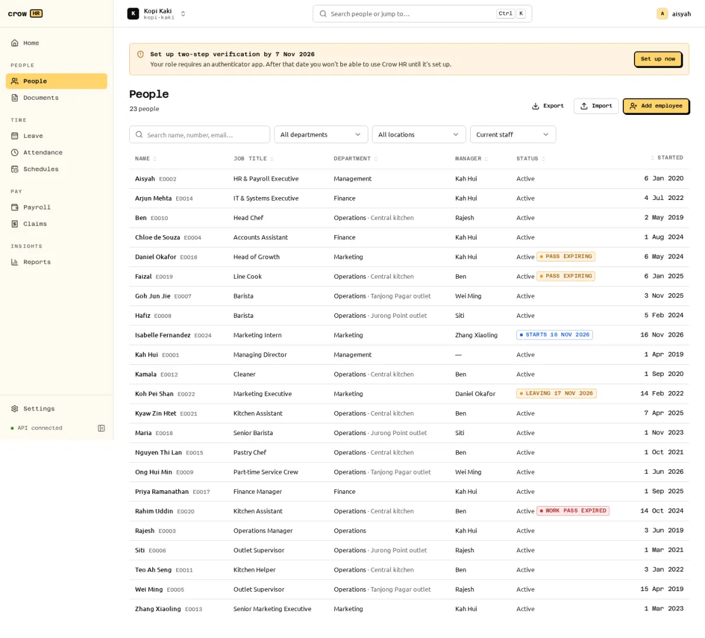

**People** lists everyone in the organisation, with filters by department, location and status. Owners and HR admins add people; payroll admins add and change pay. Managers see their team, and every member sees the directory (name, job title, department, team, location, work email and phone, manager).

## Add one employee

Choose **Add employee**. The form follows the record's sections:

| Section | Fields | Used for |
| --- | --- | --- |
| Person | Legal name, preferred name, ID type (NRIC, FIN or other) and number, date of birth, gender, nationality | Payslips, CPF age band, IR8A. NRIC and FIN must pass the check-letter test (S/T for NRIC; F/G/M for FIN, including the M series). |
| Residency | Citizen, PR (with PR start date) or foreigner | CPF rates: an SPR's first two years use graduated rates. The PR start date is required for PR and refused otherwise. |
| Race and religion | Optional | Default self-help group (SHG) fund. An SHG opt-out can be recorded with its date. |
| Contact | Work email, personal email, mobile, address | The work email receives the sign-in invitation. 8-digit mobile numbers are taken as +65. |
| Job | Start date, job title, department, team, location, cost centre, manager, employment type, work schedule, probation end | Reporting lines (manager scope), pro-ration, checklists. |
| Pay (payroll roles only) | Pay basis (monthly or hourly) and amount | Payroll. Recurring allowances are added from the profile. |
| Work pass (foreigners) | Pass type, number, issue and expiry dates | A foreigner cannot be hired without a pass valid on the start date. See [work passes](/docs/people/work-passes/). |

Saving creates the employee, their first employment period, the onboarding checklist from the default template and a sign-in invitation: emailed when SMTP is configured, otherwise shown once as a link to copy.

Checks that stop a hire:

- An ID number already used by another employee of the organisation, including a former one (`409 duplicate_id_number`). The message offers to **rehire** that person instead, which keeps their history.
- An age below the minimum employment age on the start date (13, Employment Act s 68(3)). The family-only industrial undertaking exception is not supported.
- A manager that would create a reporting cycle, or the employee as their own manager.

An existing sign-in with no employee link is linked automatically only if it holds no assigned roles. An owner or admin sign-in is never linked automatically; the hire succeeds with a message explaining why the invitation was skipped.

Employee numbers are generated as `E0001`, `E0002`… unless you enter one.

## The employee profile

The profile has tabs for the person, work, pay, history and checklists. Records that change over time (job, pay, allowances, bank account, schedule) are **effective-dated**: each change has a start date, a future date is shown as "Scheduled" and applies on the day, and you can look at what was in force on any past date.

## Sensitive fields

- **NRIC/FIN, passport and work pass numbers and bank account numbers** are encrypted in the database. NRIC/FIN is shown masked (`S****567D`), bank numbers as their last 4 digits.
- People with access can **reveal** one full value at a time. Revealing needs a recent sign-in, is limited to 30 per hour and is audit-logged.
- Pay and bank details are hidden from HR admins and managers. The API leaves such fields out and lists them in `redactedFields`.

See [roles and permissions](/docs/roles-and-permissions/) for who sees what.

## Bank account

Each employee has at most one current bank account (bank from the list of Singapore banks, account number, holder name). A new account keeps the old one as history, and payroll uses the account that is current on the pay date. Employees change their own bank details through a [change request](/docs/people/self-service-and-change-requests/).

## Export

**Export** downloads the current list (with your filters and chosen columns) as CSV or XLSX. Only columns you can read are offered, managers export only their team, and unmasked NRIC or bank numbers need a recent sign-in. Every export is audit-logged with its columns and row count.
