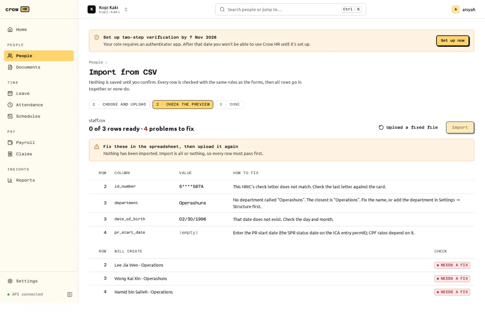

import ImportColumns from "../../../components/ImportColumns.astro";

**People → Import** loads three kinds of CSV file. Each has a downloadable template whose columns map one-to-one to fields. The column tables below are generated from the same template definitions the server uses, so they match the version you run.

## How an import works

1. Download the template, fill it in a spreadsheet and save it as CSV (UTF-8, comma-separated, with the header row). At most 5 MB and 2,000 data rows.
2. Upload it. Every row is checked with the same rules as the forms: NRIC/FIN check letters, required fields, existing department names (with the closest match suggested), dates, and so on.
3. The preview lists the rows that will be created and every problem as **row, column, value and how to fix it**. NRIC/FIN values in the preview are masked.
4. Nothing is saved until you confirm, and the confirm button stays disabled while any row has a problem. Fix the spreadsheet and **Upload a fixed file**.
5. Confirming writes all rows in one transaction, or none.

Dates accept `YYYY-MM-DD` or `DD/MM/YYYY` only. Money is in dollars with up to 2 decimals (`4000.00`) and is stored as exact cents.

## Employees

Creates employees with their first employment record and, for payroll roles, their basic pay. Each new employee gets a sign-in invitation after you confirm (see [members and roles](/docs/admin/members-and-roles/#inviting-people)). Foreigners need a work pass valid on the hire date.

<ImportColumns kind="employees" />

`manager_employee_number` can refer to an employee earlier in the same file. `pay_basis` and `basic_pay` need payroll access: an HR admin without the payroll admin role cannot import pay.

## Compensation

Records basic pay changes, effective-dated. A row dated in a month whose payroll is already approved or paid needs `retroactive` = `yes`; Crow HR then flags the back pay on the next payroll run (it is not computed for you; see [limitations](/docs/payroll/limitations/)).

<ImportColumns kind="compensation" />

## Year-to-date opening balances

Use this when you move to Crow HR during a year. CPF's additional-wage (AW) ceiling depends on the ordinary wages already paid in the year, so payroll needs the totals from your previous system. Without them, payroll warns on every employee that months before Crow HR are missing and the AW ceiling counts only the months Crow HR knows.

<ImportColumns kind="ytd" />

One row per employee and year, covering the year up to and including `through_month`, the last month paid in the previous system. For example `ow_ytd` 36000.00 with `through_month` 6 stores S$36,000.00 of ordinary wages for January to June. The next Crow HR run (July) starts from these figures.

:::caution[Check the figures]
Opening balances drive the AW ceiling for the rest of the year. Take them from your previous system's year-to-date CPF report and reconcile them against what you actually submitted to CPF before your first Crow HR run.
:::
