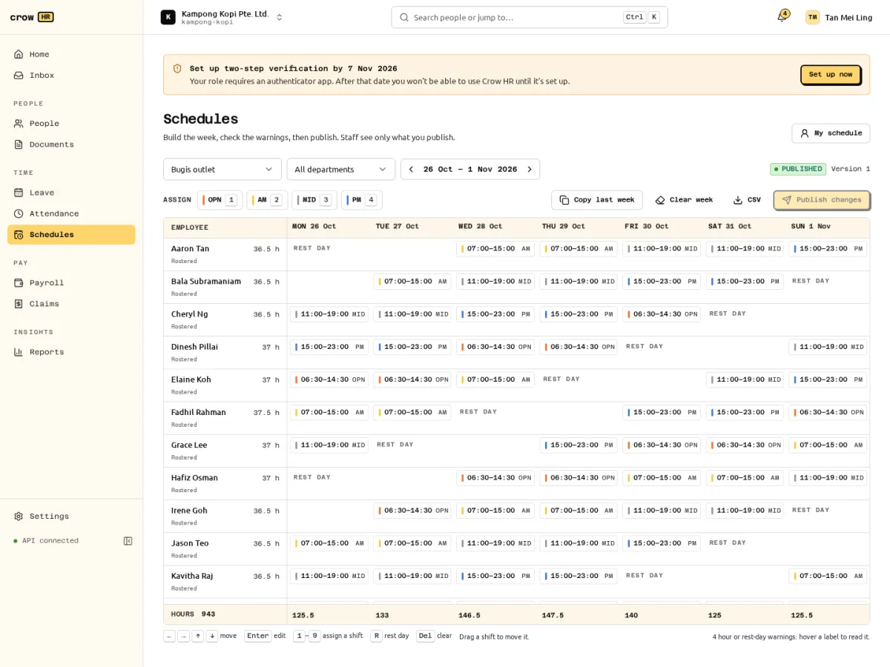
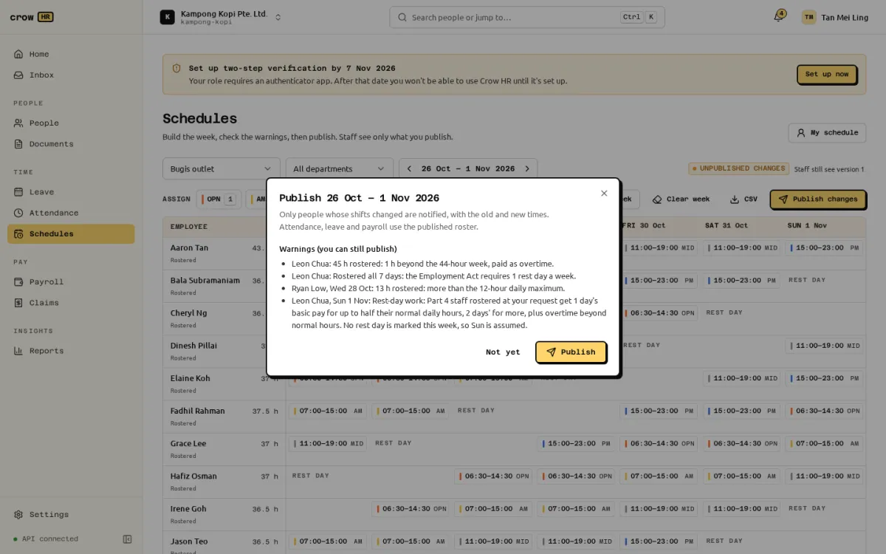

**Schedules** is where managers and HR build weekly rosters for staff without a fixed working week, check them against leave, employment dates and the Employment Act's hour limits, and publish them. Staff see their published shifts under **My schedule** (the **Shifts** tab on a phone) and can ask to swap.

Rosters matter for employees on a **shift** work schedule (see [work schedules](/docs/admin/company-and-structure/#work-schedules)). Employees on a fixed week can appear on a roster, but their attendance, leave and pay keep following their fixed schedule.

## Shift templates

Owners and HR admins define the shifts managers pick from under **Settings → Shift templates** (**Add shift**):

- a **Name** and a **Code** of 1 to 6 letters or digits (`AM`, `PM`, `OPN`), unique among active templates;
- **Starts** and **Ends**; an end at or before the start means the shift ends the next day;
- an **Unpaid break (minutes)**, shorter than the shift. **Paid time** is the length minus the break;
- an optional **Location** (shown for reference; every template is offered on every roster);
- a **Marker** colour, shown as a thin bar on the shift, never a filled cell.

A location can have at most 30 active templates. A template in use can be archived, not deleted, and editing a template doesn't change shifts already on a roster.

## Building a roster

A roster is one week (Monday to Sunday) for a **location**, a **department**, or a department at one location. Pick them at the top of **Schedules**, with the week; it opens on next week. The roster lists everyone employed in that scope during the week; it holds at most 150 employees (split it by department to roster more).

- **Click** an empty cell to add a shift there, or a shift to edit it. The editor takes a template or custom times and a break.
- **Assign**: click a template in the toolbar, then click empty cells to fill them with it; **Stop assigning** ends it.
- **Drag** a shift to another person or day to move it (it keeps its times).
- **Rest day**: mark one cell per person per week as the rest day.
- **Open shifts**: a shift with nobody on it goes in the **Open shifts** row, and anyone on the roster can ask to pick it up.
- **Copy last week** copies the previous week's roster (including unpublished edits), skipping and naming anyone who has left, wasn't employed yet or already has a shift then. Managers copy only their team's shifts and open shifts.
- **Clear week** removes every shift you can edit from the draft; what staff already see stays until you publish again.
- **CSV** downloads the week (employee, date, start, end, break, paid minutes, template and conflicts), including unpublished edits.

Each row shows the person's rostered hours for the week, and the footer the paid hours for each day.

### Keyboard shortcuts

The grid works without a mouse. Tab into it, then:

| Key | Action |
| --- | --- |
| Arrow keys | Move between cells |
| Home / End | Jump to Monday / Sunday |
| Enter or Space | Edit the cell's (first) shift, or add one |
| 1 to 9 | Put the 1st to 9th template (in start-time order) in the cell, replacing its first shift |
| R | Make the cell a rest day |
| Delete or Backspace | Remove every shift in the cell |

Below 1400 px wide, shifts show their times on two lines and drop the template code (it stays in the tooltip). On a phone, the grid becomes a list for one day at a time, with **Add shift** and **Off**; there is no keyboard or drag there.

### Who can edit

Owners and HR admins edit any roster. A manager edits rosters where at least one of their team works, and can roster only their team, so a manager can't roster themselves. Two people editing the same roster see each other's changes when they reload; editing a shift that someone else changed in the meantime is refused with "Someone else changed this shift since you opened the roster. Reload and try again." A shift that overlaps another shift for the same person, on any roster, can't be saved.

## Publishing

Staff see only the **published** roster, never the draft. The status beside the week says **Draft** (not visible to staff yet), **Published** (with its version) or **Unpublished changes** (staff still see the previous version).

**Publish** (or **Publish changes**) opens a check:

- **Check these before publishing**: conflicts that must each be ticked to acknowledge them. Acknowledgements are recorded in the audit log.
- **Warnings (you can still publish)**: hour and pay warnings.

The first publish of a week notifies everyone with a shift ("Your schedule for the week of 2 Nov 2026 is published"). Publishing again notifies only the people whose shifts changed, with the old and new times ("Your shift on Wed 4 Nov 2026 changed from 09:00–17:00 to 10:00–18:00"). Notifications are in-app and by email when SMTP is set, to staff with a sign-in.

## Conflicts and hour warnings

| What | Label on the grid | Effect |
| --- | --- | --- |
| Two shifts overlap for one person | Overlaps | Can't be saved |
| Approved leave on the date (a half day is checked against the shift's hours) | On leave | Must be acknowledged to publish |
| Before the start date or after the last day of employment | Not employed | Must be acknowledged to publish |
| Pending leave on the date | Leave pending | Hint on the grid only |
| Hours beyond normal daily hours (8 h when rostered more than 5 days that week, otherwise 9) | Overtime | Hint on the grid only |
| A shift on a public holiday | Holiday name | Warning, with what Part 4 staff are owed |
| A shift on the rest day | Rest day | Warning, with what Part 4 staff are owed |
| More than 12 hours in a day | Over 12 h | Warning |
| More than 44 normal hours in the week | Over 44 h | Warning |
| Paid time on all 7 days | No rest day | Warning |
| Projected overtime above 72 hours in the calendar month | Over 72 h OT | Warning |

The hour warnings are planning checks from the Employment Act's limits, computed from rostered paid time across all rosters, drafts included. They show for everyone: Crow HR does not check whether each employee is covered by Part 4. The 72-hour check counts rostered overtime only; attendance checks claimed overtime separately. Without a marked rest day, the work schedule's rest day applies, or Sunday for shift schedules ("rest Sun (assumed)"). The rule that a rest day other than Sunday must be set before the month starts is not checked.

The pay text on rest-day and public-holiday shifts (a day's or two days' basic pay for rest-day work, an extra day's pay for holiday work) is guidance from the statutory engine; payroll does not price these shifts from the roster.

## Swaps and open shifts

Staff work from **My schedule**, which lists the next 14 days of published shifts ("Next week's schedule hasn't been published yet" when it isn't).

- **Swap**: on one of your shifts, choose a colleague on the same roster and either **Swap for one of their shifts** or **Give it away**, with a note, and **Send request**. The colleague gets a notification and an item on Home ("Swap your Tue for Aaron's Wed?") to **Accept** or **Decline**.
- **Pick up** an open shift from the **Open shifts** list.

An accepted swap, or a pickup, goes for approval as a **Shift swaps** request, to the requester's **manager** by default (escalating after 2 days). On approval the shifts move in both the published roster and the draft, after checking again that nobody ends up overlapping or outside their employment; the published version number goes up.

Rules: swaps stay within one roster; a shift with unpublished edits can't be offered until the roster is published again; one open request per shift. The requester can cancel before approval, and a request that is still open when the earlier shift starts expires. Editing, deleting or clearing a shift cancels its swap requests and tells both people.

## How a published roster is used

Only published rosters count; drafts never do. For employees on a shift schedule:

### Attendance

On a date with a published roster, lateness, early out and overtime in [attendance](/docs/attendance/attendance/) are measured against the shift: lateness from its start, early out from its end, with its own break. Work on an unrostered day or the rest day is all overtime. Without a published roster there is no start time, so lateness and early out are not computed.

### Leave

In a week covered by a published roster, a leave request counts only the days with a shift; the date list says "Not rostered" or "Rest day" for the others. Weeks without a published roster count every day except public holidays, with a warning. The count is fixed when leave is applied for.

When leave is approved after a roster was published, the roster's last publisher and the HR admins are told "Nadia Rahman's approved leave overlaps a published shift … Reassign the shifts or mark them open, then publish the roster again." The shift shows **On leave** in the editor and must be acknowledged at the next publish. Shifts are not removed automatically.

### Payroll scheduled days

Payroll pro-rates an incomplete month for staff without a fixed week from their **scheduled days** and **days worked** (Employment Act s 20A). Crow HR supplies them:

- **Scheduled days** come from published rosters ("Scheduled days (from published roster)"): the shift days, plus public holidays not on a rest day, plus approved leave days. They are supplied only when every date of the month has a published roster for the employee and the employee was employed for the whole month; otherwise HR enters them on the run (MOM's denominator is the whole month).
- **Days worked** come from [attendance](/docs/attendance/attendance/#how-approved-overtime-reaches-payroll) for staff who clock in.
- A "Scheduled days" or "Days worked" item entered by hand on the run wins over the fed one.
- If days worked exceed scheduled days (for example work on an unrostered day), the run blocks with `ROSTER_DAYS_INVALID` for HR to decide.

## Reports

[Reports](/docs/reports/running-reports/) has **Scheduled hours**: shifts, rest days and paid hours per employee from published rosters, for up to 62 days.

## Who can do what

| | Owner, HR admin | Payroll admin | Manager | Employee |
| --- | --- | --- | --- | --- |
| Shift templates | Edit | — | Use | — |
| Rosters: build and publish | Any | — | Their team | — |
| See published rosters | All | — | Their team | Rosters they are on |
| Swap, give away, pick up | Own shifts | — | Own shifts | Own shifts |

See the [permission matrix](/docs/roles-and-permissions/).

## Limitations

- No real-time collaboration: changes appear on reload.
- Drag moves a shift (no copy-drag). A cell can hold several shifts, but Enter, 1–9 and R act on the first one.
- Open shifts are picked up through approval only; there is no first-come assignment.
- The approver's link from a shift swap task opens My schedule, not the roster week, and notification links always open the next 14 days.
- The CSV export is for editors only and includes unpublished edits; staff see the published roster on screen.
